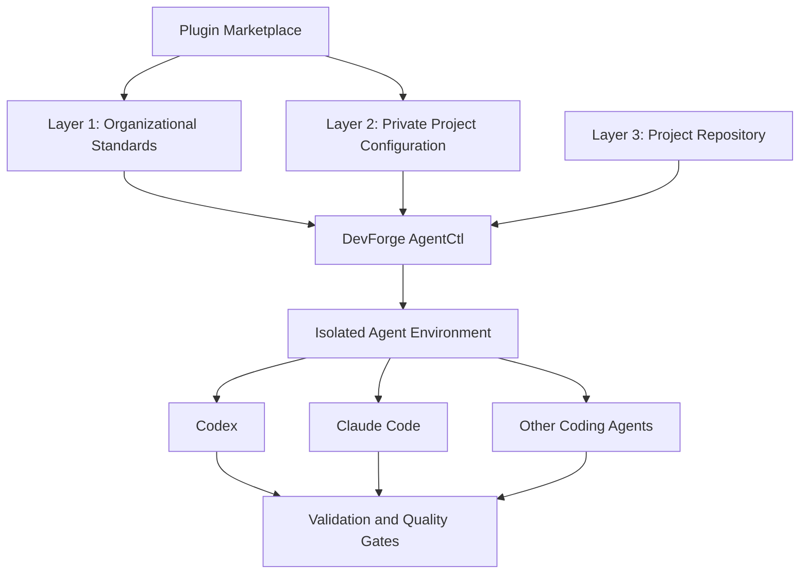
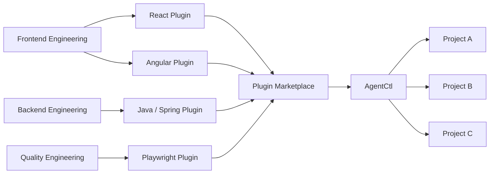
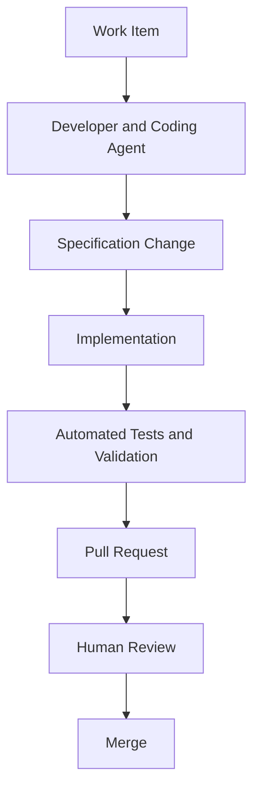
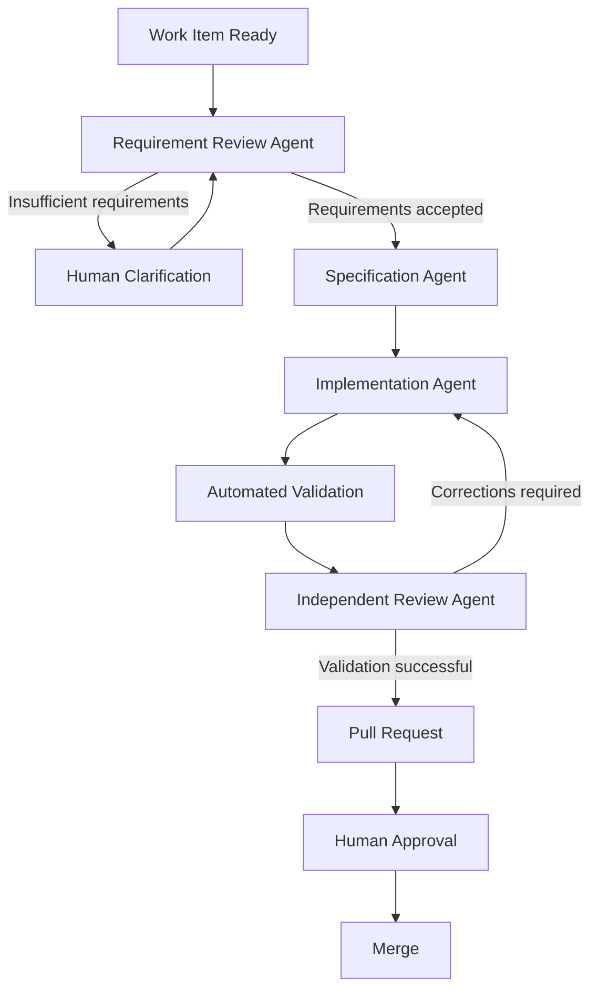

# DevForge Framework

**A technology-agnostic framework for standardized, governed, and scalable AI-assisted software development.**

DevForge establishes a common foundation for engineering teams working with AI coding agents. It combines reproducible agent environments, reusable technology plugins, enforceable engineering standards, and specification-driven development.

Its long-term vision is to enable the gradual evolution from developer-driven AI-assisted engineering towards an autonomous, agentic Software Factory.

## Motivation

AI coding agents significantly accelerate software development. However, scaling their use across multiple developers, teams, and technology stacks introduces new challenges:

- Inconsistent agent configurations and capabilities.
- Diverging implementations and architectural decisions.
- Uncontrolled access to sensitive information.
- Inconsistent application of engineering standards.
- Increasing integration and review complexity.
- Fragmented knowledge and outdated specifications.
- Limited reproducibility of AI-assisted development environments.

DevForge addresses these challenges by standardizing the environment in which AI agents operate, rather than prescribing a specific AI model, coding agent, or technology stack.

## Core Principles

- **Reproducibility:** Developers working on the same project operate with equivalent, versioned agent configurations.
- **Technology Independence:** Engineering standards are distributed through technology-specific plugins.
- **Separation of Concerns:** Organizational standards, private project configuration, and deliverable project artifacts remain separate.
- **Specification-Driven Development:** Functional specifications describe the intended system behavior and evolve alongside the implementation.
- **Policy Enforcement:** Mandatory rules are supported by hooks, validators, and automated quality gates.
- **Extensibility:** Organizations can introduce additional plugins, policies, integrations, and agent capabilities.
- **Progressive Automation:** Developer-driven workflows can gradually evolve into orchestrated agentic processes.
- **Human Accountability:** Changes remain reviewable, traceable, and subject to appropriate approval.

## Architecture

DevForge introduces three distinct configuration layers that are assembled into a consistent AI development environment.



### Layer 1 — Organizational Standards

Defines mandatory engineering, security, and operational standards applicable across an organization.

Typical contents include:

- Mandatory security policies.
- Organization-wide agent instructions.
- Required plugins and minimum versions.
- Mandatory hooks and validators.
- Approved MCP servers and integrations.
- Commit conventions.
- Engineering and quality standards.

These requirements cannot be weakened by project-level configuration.

### Layer 2 — Private Project Configuration

Defines how organizational standards and reusable capabilities are applied to a specific customer, project, or workspace.

Typical contents include:

- Project manifests.
- Technology-specific plugin selections.
- Version constraints and lockfiles.
- Repository and directory mappings.
- Project-specific agent instructions.
- Additional policies and hooks.
- MCP server configuration.
- Knowledge source configuration.

This layer can be maintained in a separate, private repository to protect proprietary engineering knowledge and internal operational practices.

### Layer 3 — Project Repository

Contains the actual software product and its deliverable artifacts.

Typical contents include:

- Application source code.
- Automated tests.
- Functional and architectural specifications.
- Project-specific documentation.
- Additional project-level agent instructions, where appropriate.

The project repository does not need to contain proprietary organizational standards or private agent configurations.

## Plugin Ecosystem

DevForge uses independently versioned plugins to distribute reusable engineering knowledge, agent capabilities, and validation mechanisms.

A plugin may contain:

| Component | Purpose |
|---|---|
| Skills | Specialized knowledge and reusable engineering workflows |
| Agents | Dedicated roles and task-specific agent definitions |
| Instructions | Coding conventions and architectural guidelines |
| Hooks | Event-driven policy and workflow checks |
| Validators | Deterministic quality and compliance checks |
| MCP definitions | External tools and knowledge integrations |
| Templates | Reusable implementation and configuration patterns |

Plugins are technology-specific, independently maintained, and associated with clearly defined ownership.

Example plugins include:

- `frontend-react`
- `frontend-angular`
- `backend-java-spring`
- `testing-playwright`
- `platform-security`
- `architecture-clean`

A single engineering team may maintain multiple plugins for different technology stacks.

### Plugin Marketplace

Organizations can operate their own private or public plugin marketplaces.



Plugin maintainers develop, test, version, and publish their releases independently. The marketplace provides a central distribution mechanism for approved plugin versions.

Projects select the capabilities required by their technology stack and organizational policies.

DevForge does not require organizations to publish their internal plugins, policies, or engineering knowledge publicly.

## DevForge AgentCtl

[DevForge AgentCtl](https://github.com/bechte/devforge-agentcli) is the companion command-line toolkit for assembling, configuring, validating, and maintaining DevForge development environments.

AgentCtl is designed to provide:

- Isolated agent configuration environments.
- Declarative workspace configuration.
- Plugin resolution and installation.
- Controlled configuration and filesystem mappings.
- Agent-specific configuration adapters.
- Centralized hook management.
- Policy validation.
- Environment diagnostics.
- Controlled updates.

The intended command-line interface includes:

```bash
agentctl init
agentctl setup
agentctl doctor
agentctl update

agentctl start codex
agentctl start claude
```

Additional management capabilities are envisioned:

```bash
agentctl plugin list
agentctl plugin update

agentctl policy validate

agentctl hooks list
agentctl hooks verify
```

AgentCtl translates the technology-independent DevForge configuration model into the mechanisms supported by individual coding agents.

The commands above describe the intended interface and are not a guarantee of currently implemented functionality.

## Reproducible Development Environments

DevForge separates personal AI configurations from project-specific engineering environments.

Each managed project operates with a dedicated agent configuration context assembled from:

- Organizational requirements.
- Approved plugin versions.
- Private project configuration.
- Project-level instructions.
- Authorized tools and integrations.

Versioned plugins, configuration manifests, and lockfiles provide a reproducible configuration baseline.

Mandatory minimum versions allow organizations to enforce critical security and engineering updates without introducing uncontrolled configuration changes into active projects.

Equivalent environments do not guarantee identical AI-generated implementations. They establish consistent capabilities, constraints, and verification mechanisms.

## Policy Enforcement

DevForge distinguishes three complementary enforcement mechanisms.

### Guidance

Agent instructions, skills, architectural documentation, and engineering guidelines influence agent behavior.

### Deterministic Enforcement

Hooks, linters, static analysis, architecture tests, contract tests, and CI quality gates validate requirements that can be checked programmatically.

### Semantic Validation

AI-assisted reviews evaluate architectural consistency, implementation quality, specification compliance, and other aspects that cannot be fully expressed through deterministic rules.

Organizational policies take precedence over plugin and project-level configuration. Additional configuration may strengthen mandatory requirements but must not weaken them.

Local hooks and isolated configuration directories are not security boundaries. Sensitive resources require appropriate access controls, sandboxing, credential management, and independent server-side verification.

## Specification-Driven Development

DevForge encourages projects to maintain a living specification describing the current intended behavior of the system.

A recommended repository structure is:

```text
project/
├── frontend/
├── backend/
├── services/
├── tests/
└── specs/
    ├── README.md
    ├── architecture/
    └── domains/
        ├── customers/
        ├── orders/
        └── billing/
```

Specifications are organized around business domains and capabilities rather than historical work items.

A specification should describe relevant:

- Functional behavior.
- Business rules.
- Acceptance criteria.
- Architectural constraints.
- Test references.

Work items describe requested changes. Living specifications describe the resulting system state.

Code, tests, and specification changes should be reviewed and integrated together. Git revisions and deployment references provide traceability between specifications and deployed software versions.

External knowledge sources, such as documentation platforms and issue trackers, may also be integrated. Each project should establish an authoritative specification source and avoid independently maintained copies.

## Development Workflow

The initial DevForge adoption model remains developer-driven.



Developers remain responsible for initiating work, resolving ambiguities, validating implementations, and preparing changes for review.

DevForge standardizes the environment, engineering capabilities, and quality requirements supporting this process.

Specification changes should be established before implementation. Implementation agents should not independently redefine requirements to justify their implementation.

## Vision: The Agentic Software Factory

DevForge is designed to support a gradual transition towards increasingly automated software engineering.

The long-term vision is an orchestrated workflow in which specialized agents collaborate on well-defined engineering tasks.



The envisioned Software Factory reuses the same organizational standards, plugins, policies, specifications, and validation mechanisms established during developer-driven adoption.

Potential future capabilities include:

- Automated work item qualification.
- Specification change generation.
- Cross-agent coordination.
- Change impact analysis.
- Parallel implementation workflows.
- Independent architecture and code reviews.
- Automated remediation with bounded retry cycles.
- Automated pull request preparation.
- Policy-driven approval and integration.

Autonomous execution is an extension of the framework, not a prerequisite for its adoption.

## Repository Structure

The intended structure of this repository is:

```text
devforge-framework/
├── README.md
├── LICENSE
├── docs/
│   ├── architecture/
│   ├── configuration/
│   ├── plugins/
│   ├── policies/
│   ├── specifications/
│   └── workflows/
├── schemas/
├── examples/
│   ├── organization/
│   ├── marketplace/
│   └── projects/
└── assets/
```

This repository focuses on the framework architecture, configuration contracts, documentation, and reference examples.

The executable environment management toolkit is maintained separately in the [DevForge AgentCtl repository](https://github.com/bechte/devforge-agentcli).

## Roadmap

### Phase 1 — Standardized AI Development

- Three-layer configuration architecture.
- Plugin and marketplace contracts.
- Reproducible agent environments.
- AgentCtl integration.
- Mandatory policies and hook management.
- Specification-driven development.
- Developer-driven workflows.

### Phase 2 — Coordinated AI Development

- Standardized agent workflows.
- Automated specification validation.
- Architecture compliance checks.
- Independent AI-assisted reviews.
- Cross-team change impact analysis.
- Improved integration of parallel development activities.

### Phase 3 — Agentic Software Factory

- Event-driven workflow orchestration.
- Specialized collaborating agents.
- Automated implementation and verification cycles.
- Ticket-to-pull-request automation.
- Configurable human approval gates.

## Project Status

DevForge is currently an architecture and framework initiative.

The concepts, configuration contracts, plugin interfaces, and reference implementations are subject to refinement. Tool-specific integration capabilities must be validated against supported coding agent versions.

The framework intentionally avoids dependencies on a particular AI provider, model, programming language, or organizational structure.

## Contributing

Contributions to the framework, architectural concepts, configuration contracts, and reference implementations are welcome.

Proposed changes should preserve the core principles of technology independence, reproducibility, extensibility, separation of concerns, and progressive automation.

## License

Copyright © 2026 Stefan Bechtold.

Licensed under the [Apache License, Version 2.0](https://www.apache.org/licenses/LICENSE-2.0).

SPDX-License-Identifier: Apache-2.0

---

**DevForge — From standardized AI-assisted development to the agentic Software Factory.**
