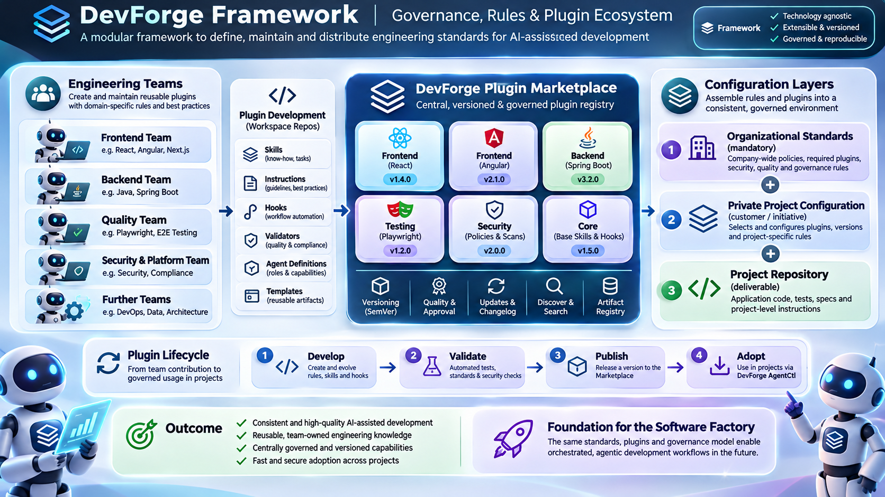

# DevForge Framework

**A technology-agnostic framework for standardized, governed, and scalable AI-assisted software development.**

DevForge establishes a common foundation for engineering teams working with AI coding agents. It combines distributed engineering knowledge, centralized governance, reusable plugins, and reproducible development environments.

Its long-term vision is to enable the gradual evolution from developer-driven AI-assisted engineering towards an agentic Software Factory.

## DevForge Framework — Big Picture



DevForge enables organizations to develop engineering standards collaboratively, distribute them centrally, and apply them consistently across software projects.

The [Framework Specification](docs/SPECIFICATION.md) defines the underlying architecture, configuration contracts, governance model, and conformance requirements.

## Motivation

AI coding agents significantly accelerate software development. However, scaling their use across developers, teams, and technology stacks introduces new challenges:

- Inconsistent agent configurations and capabilities.
- Diverging implementations and architectural decisions.
- Inconsistent application of engineering and security standards.
- Fragmented engineering knowledge.
- Increasing integration and review complexity.
- Limited reproducibility of development environments.

DevForge addresses these challenges by standardizing the environment in which AI agents operate, without prescribing a specific AI provider, coding agent, or technology stack.

## Core Principles

| Principle | Description |
|---|---|
| Technology Independence | Framework contracts remain independent of coding agents and technology stacks. |
| Separation of Concerns | Organizational standards, private project configuration, and deliverable software artifacts remain separate. |
| Reproducibility | Development environments are assembled from explicitly declared and versioned configuration sources. |
| Distributed Ownership | Engineering teams maintain the knowledge and capabilities within their respective technical domains. |
| Central Governance | Organizations define mandatory standards that cannot be weakened by individual projects. |
| Progressive Automation | Developer-driven workflows can gradually evolve into orchestrated agentic processes. |

See [Architectural Principles](docs/SPECIFICATION.md#3-architectural-principles) for the normative framework requirements.

## Configuration Layers

DevForge introduces three configuration layers that are combined into a consistent agent environment.

| Layer | Responsibility |
|---|---|
| **1 — Organizational Standards** | Organization-wide policies, mandatory plugins, engineering standards, and security requirements. |
| **2 — Private Project Configuration** | Technology stack selection, plugin versions, project-specific rules, and integrations. |
| **3 — Project Repository** | Application code, automated tests, living specifications, and additional project-level instructions. |

Each layer contributes to the effective configuration while preserving its ownership, scope, and authority.

Mandatory organizational requirements cannot be weakened by plugins, project configurations, or local developer preferences.

Proprietary organizational knowledge and private project configurations remain separate from deliverable software artifacts.

**Further reading:**

- [Repository Architecture](docs/SPECIFICATION.md#5-repository-architecture)
- [Three-Layer Configuration Model](docs/SPECIFICATION.md#6-three-layer-configuration-model)
- [Rule Development and Composition](docs/SPECIFICATION.md#7-rule-development-and-composition)

## Plugin Marketplace

DevForge combines decentralized plugin development with centrally governed distribution.

Engineering teams develop and maintain reusable plugins within their own workspaces. These plugins package technology-specific knowledge and capabilities, including skills, instructions, agent definitions, hooks, and validators.

Approved, independently versioned plugin releases are published to a central Marketplace and made available to managed projects.

Organizations can operate their own private marketplaces, curate external plugins, and establish publication and approval requirements without exposing proprietary engineering knowledge.

The Marketplace is a logical framework component and can be implemented using existing artifact repositories or package registries.

**Further reading:**

- [Plugin Architecture](docs/SPECIFICATION.md#8-plugin-architecture)
- [Central Plugin Marketplace](docs/SPECIFICATION.md#9-central-plugin-marketplace)
- [Governance and Ownership](docs/SPECIFICATION.md#10-governance-and-ownership)

## Reproducible Development Environments

DevForge separates personal AI configurations from managed, project-specific agent environments.

Organizational standards, approved plugins, private project configurations, and project-level instructions are assembled into a dedicated configuration context.

Versioned artifacts, manifests, and lockfiles establish a reproducible baseline. Agent-specific adapters translate this baseline into the configuration mechanisms supported by individual coding agents.

This enables developers working on the same project to operate with consistent capabilities, constraints, and validation mechanisms, without requiring identical AI-generated output.

DevForge supports native development environments and does not require containerization. Configuration isolation alone does not constitute a security boundary.

**Further reading:**

- [Project Configuration and Dependency Resolution](docs/SPECIFICATION.md#11-project-configuration-and-dependency-resolution)
- [Environment Assembly](docs/SPECIFICATION.md#12-environment-assembly)
- [Agent Integration](docs/SPECIFICATION.md#13-agent-integration)
- [Security and Trust Model](docs/SPECIFICATION.md#15-security-and-trust-model)

## Getting Started

### Establish a Framework Instance

Organizations adopt DevForge by establishing their own framework instance:

1. Define organizational engineering standards, policies, and governance responsibilities.
2. Establish a trusted Plugin Marketplace.
3. Enable engineering teams to develop and publish reusable plugins.
4. Create project configurations referencing approved plugins and applicable standards.
5. Assemble and validate managed agent environments.

Each organization retains ownership of its standards, plugins, and project configurations.

### Set Up Development Environments

[DevForge AgentCtl](https://github.com/bechte/devforge-agentcli) is the intended reference implementation for assembling, configuring, validating, and maintaining local DevForge environments.

Its proposed command-line interface includes:

```bash
agentctl init
agentctl setup
agentctl doctor
agentctl update
agentctl start codex
```

AgentCtl manages the technical integration of configuration layers, plugins, policies, hooks, and coding agent adapters.

For installation instructions, supported agents, and implementation details, refer to the [DevForge AgentCtl repository](https://github.com/bechte/devforge-agentcli).

### Apply DevForge in Software Projects

Developers use their preferred supported coding agent within a managed project environment.

Development remains specification-driven: work items describe requested changes, while living specifications describe the intended behavior of the system.

Implementation, automated tests, and specification changes are reviewed and integrated together, supported by applicable engineering standards and quality gates.

Developers remain accountable for engineering decisions and implementation quality.

**Further reading:**

- [Policy Enforcement and Validation](docs/SPECIFICATION.md#14-policy-enforcement-and-validation)
- [Specification-Driven Development](docs/SPECIFICATION.md#16-specification-driven-development)
- [Development Workflows](docs/SPECIFICATION.md#17-development-workflows)

## Vision — The Agentic Software Factory

DevForge provides the foundation for a gradual transition towards orchestrated, agentic software development.

Future Software Factory implementations can reuse the same organizational standards, plugins, specifications, policies, and validation mechanisms to coordinate specialized agents — from requirement qualification to implementation, testing, review, and pull request creation.

Autonomous execution is an extension of the framework, not a prerequisite for its adoption.

See [Agentic Software Factory](docs/SPECIFICATION.md#18-agentic-software-factory).

## Documentation

| Resource | Description |
|---|---|
| [Framework Specification](docs/SPECIFICATION.md) | Detailed architecture, normative requirements, configuration contracts, and governance model. |
| [Framework Conformance](docs/SPECIFICATION.md#19-framework-conformance) | Proposed implementation conformance profiles. |
| [Open Architecture Decisions](docs/SPECIFICATION.md#21-open-architecture-decisions) | Outstanding technical decisions and proposed directions. |
| [DevForge AgentCtl](https://github.com/bechte/devforge-agentcli) | Companion CLI for managed development environments. |

## Project Status

DevForge is currently an architecture and framework initiative. Its contracts, schemas, conformance profiles, and reference implementations are under development.

Contributions to the framework, architectural concepts, and reference implementations are welcome.

## License

Copyright © 2026 Stefan Bechtold.

Licensed under the [Apache License, Version 2.0](https://www.apache.org/licenses/LICENSE-2.0).

SPDX-License-Identifier: Apache-2.0

---

**DevForge — From standardized AI-assisted development to the agentic Software Factory.**