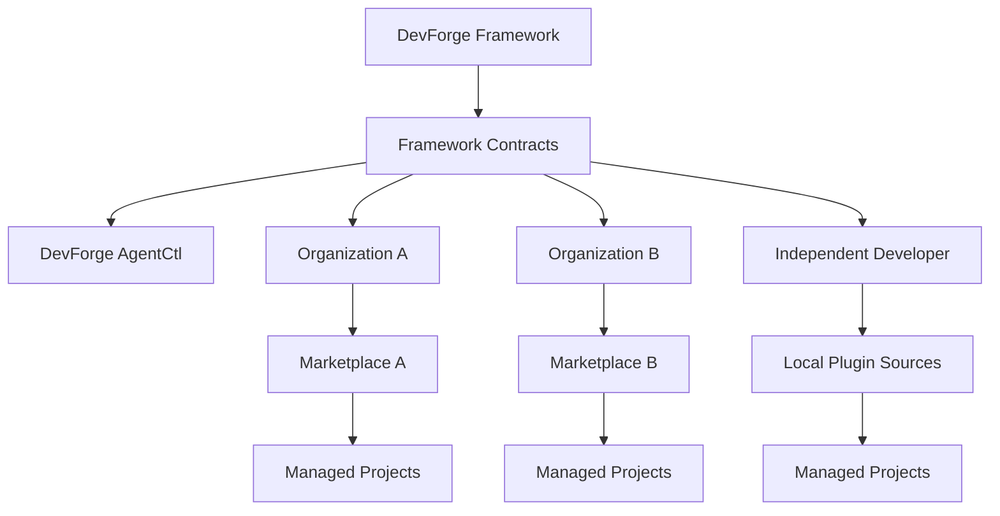
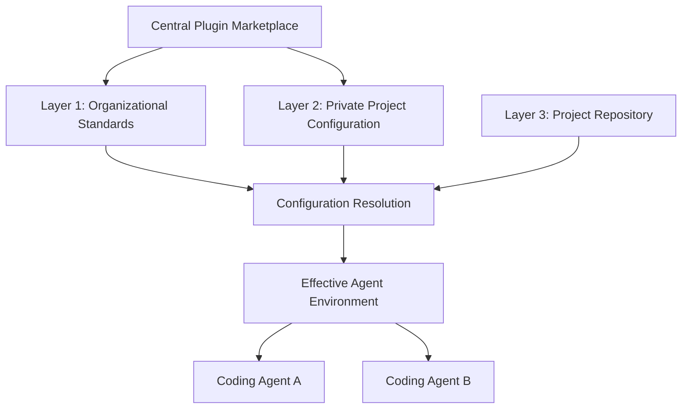
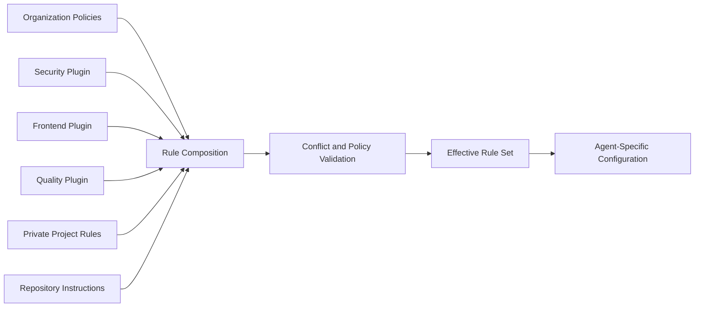
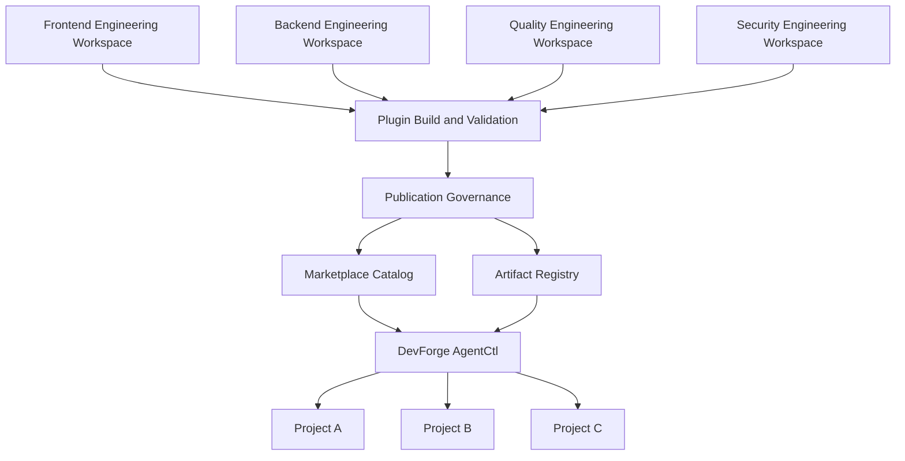
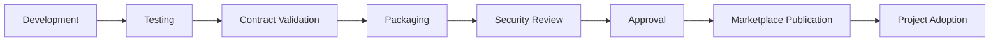
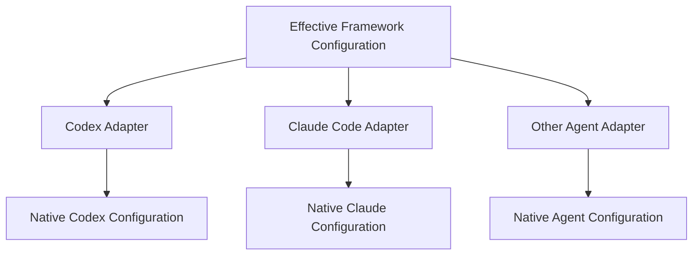
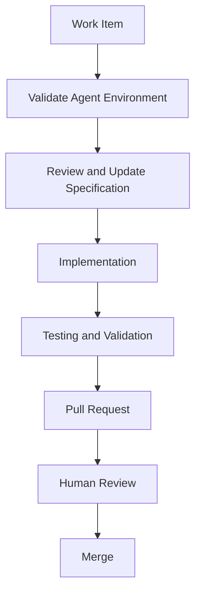
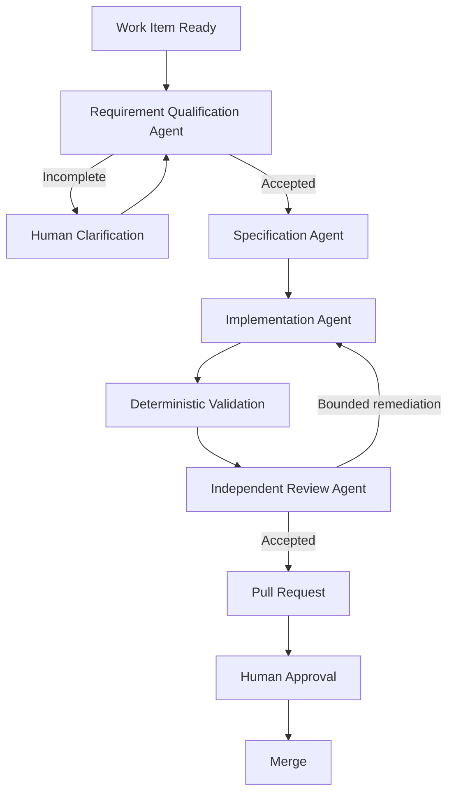

# DevForge Framework Specification

## 1. Purpose and Scope

DevForge defines an open, technology-independent framework for establishing standardized, reproducible, governed, and extensible AI-assisted software development environments.

The framework enables organizations to distribute engineering knowledge, agent capabilities, architectural guidelines, security policies, and automated validation mechanisms across independently managed software projects.

DevForge does not prescribe a specific:

- AI provider or language model.
- Coding agent.
- Programming language.
- Application architecture.
- Repository hosting platform.
- Organizational structure.
- Development methodology.

Instead, DevForge defines architectural principles, configuration contracts, governance mechanisms, and integration patterns that establish a consistent foundation for AI-assisted software engineering.

The framework is designed to support both developer-driven engineering and future autonomous software development workflows.

## 2. Terminology and Normative Language

The keywords MUST, MUST NOT, SHOULD, SHOULD NOT, and MAY describe normative requirements in accordance with RFC 2119.

| Term | Definition |
|---|---|
| Framework | The architectural model, contracts, principles, and rules defined by DevForge. |
| Framework Instance | An organization-specific implementation of the DevForge Framework. |
| Marketplace | A centrally governed distribution mechanism for versioned plugins. |
| Plugin | An independently versioned package of reusable engineering capabilities. |
| Plugin Workspace | A repository in which one or more plugins are developed and maintained. |
| Policy | A mandatory or optional requirement governing development activities. |
| Skill | Reusable knowledge or instructions supporting specialized engineering tasks. |
| Hook | An event-driven mechanism executing a defined action or validation. |
| Validator | A mechanism evaluating compliance with a defined requirement. |
| Adapter | A component translating framework contracts into tool-specific configurations. |
| Manifest | A declarative description of configuration, dependencies, and capabilities. |
| Lockfile | A record of resolved versions and artifact identities. |
| Agent Environment | The effective configuration context in which a coding agent operates. |

## 3. Architectural Principles

### 3.1 Technology Independence

Framework contracts MUST remain independent of individual coding agents and technology stacks.

Tool-specific behavior MUST be encapsulated through adapters.

Technology-specific knowledge SHOULD be distributed through plugins rather than embedded into the framework core.

### 3.2 Separation of Concerns

DevForge separates the following responsibilities:

- Framework architecture and contracts.
- Organizational governance.
- Technology-specific engineering knowledge.
- Project-specific configuration.
- Deliverable software artifacts.
- Environment assembly and execution.

Each responsibility MAY be maintained in a separate repository.

Repository boundaries do not necessarily correspond to application architecture boundaries.

### 3.3 Reproducibility

Effective agent environments MUST be derived from explicitly declared configuration sources.

Plugin versions and resolved dependencies MUST be recorded.

Environment assembly SHOULD be deterministic for equivalent inputs.

Reproducibility applies to configuration, capabilities, and constraints. It does not imply deterministic AI-generated output.

### 3.4 Distributed Ownership

Engineering knowledge SHOULD be maintained by the teams responsible for the corresponding technical domains.

Central governance MUST NOT require all engineering knowledge to be developed within a single repository.

### 3.5 Central Governance

Organizations MUST be able to define mandatory requirements applicable across all managed projects.

Mandatory requirements MUST NOT be weakened by plugins, project configurations, or local developer preferences.

### 3.6 Progressive Automation

The framework MUST support developer-driven adoption without requiring autonomous workflow orchestration.

Future automation SHOULD reuse existing configuration contracts, policies, plugins, and validation mechanisms.

## 4. Framework Architecture

DevForge distinguishes between the public framework definition and independently operated framework instances.



The public framework defines the common architecture.

Each framework instance defines its own:

- Governance model.
- Organizational policies.
- Trusted plugin sources.
- Marketplace configuration.
- Approved integrations.
- Project configurations.
- Access control mechanisms.

The public framework does not require organizations to share proprietary engineering knowledge.

## 5. Repository Architecture

### 5.1 Repository Types

A DevForge implementation SHOULD distinguish between the following repository types.

| Repository | Responsibility |
|---|---|
| Framework Repository | Public architecture, contracts, documentation, and examples. |
| CLI Repository | Environment management and framework implementation tooling. |
| Organization Repository | Mandatory standards, governance, and marketplace configuration. |
| Plugin Workspace | Development and maintenance of reusable plugins. |
| Private Project Configuration Repository | Project-specific internal configuration. |
| Project Repository | Deliverable software, tests, and specifications. |

### 5.2 Reference Repository Landscape

```text
devforge-framework/
devforge-agentcli/

organization-devforge/
organization-devforge-frontend/
organization-devforge-backend/
organization-devforge-quality/
organization-devforge-security/

customer-a-devforge-config/
customer-a-application/

customer-b-devforge-config/
customer-b-application/
```

The repository landscape is illustrative.

Organizations MAY consolidate repositories where ownership, access control, and independent release management remain sufficiently separated.

### 5.3 Framework Repository

The public framework repository contains:

- Architectural specifications.
- Configuration contracts.
- Plugin contracts.
- Marketplace contracts.
- Governance principles.
- Conformance requirements.
- Reference examples.

It MUST NOT require proprietary organizational configurations.

### 5.4 Organization Repository

The organization repository represents the central governance authority of a framework instance.

It SHOULD contain:

```text
organization-devforge/
├── organization.yaml
├── policies/
├── instructions/
├── hooks/
├── validators/
├── integrations/
├── marketplace/
│   ├── catalog.yaml
│   ├── trusted-publishers.yaml
│   └── revocations.yaml
└── schemas/
```

This repository defines which requirements are mandatory and which capabilities are approved for use.

### 5.5 Plugin Workspaces

Plugin workspaces are independently maintained development repositories.

A frontend engineering team may maintain multiple plugins within a single workspace.

```text
organization-devforge-frontend/
├── plugins/
│   ├── react/
│   │   ├── plugin.yaml
│   │   ├── skills/
│   │   ├── instructions/
│   │   ├── hooks/
│   │   └── tests/
│   └── angular/
│       ├── plugin.yaml
│       ├── skills/
│       ├── instructions/
│       └── tests/
└── .github/
    └── workflows/
```

Plugins MUST support independent versioning, even when maintained within a shared workspace.

The workspace is the source of development.

The marketplace is the source of approved distribution.

Projects SHOULD consume published plugin artifacts rather than directly referencing mutable workspace branches.

## 6. Three-Layer Configuration Model

DevForge defines three configuration layers.



Plugins are reusable configuration contributions consumed by the layers. They do not constitute an independent authority layer.

### 6.1 Layer 1 — Organizational Standards

Layer 1 defines organization-wide requirements.

Examples include:

- Mandatory security policies.
- Required engineering standards.
- Approved AI providers.
- Mandatory plugins.
- Minimum plugin versions.
- Approved MCP integrations.
- Mandatory hooks and validators.
- Commit conventions.
- Quality gate requirements.

Layer 1 MUST be authoritative for mandatory organizational requirements.

### 6.2 Layer 2 — Private Project Configuration

Layer 2 adapts organizational standards to individual projects.

Examples include:

- Technology stack selection.
- Plugin dependencies.
- Plugin lockfiles.
- Repository mappings.
- Project-specific engineering knowledge.
- Additional policies.
- Additional hooks.
- Knowledge source configuration.
- Agent-specific configuration requirements.

Layer 2 MAY be maintained in a separate private repository.

It MUST NOT weaken mandatory Layer 1 requirements.

### 6.3 Layer 3 — Project Repository

Layer 3 contains deliverable software artifacts.

Examples include:

- Application source code.
- Automated tests.
- Functional specifications.
- Architectural documentation.
- Project-specific agent instructions.
- Build and deployment configurations.

Layer 3 MAY introduce additional requirements and contextual instructions.

It MUST NOT override mandatory requirements originating from higher-authority layers.

Proprietary Layer 1 and Layer 2 artifacts MUST NOT be unintentionally committed into Layer 3.

## 7. Rule Development and Composition

### 7.1 Distributed Rule Development

Rules may originate from different repositories and responsible teams.

| Rule Origin | Example |
|---|---|
| Organization Security Team | Prohibit unauthorized credential access. |
| Architecture Team | Require architectural dependency validation. |
| Frontend Engineering Team | Define React component conventions. |
| Backend Engineering Team | Define service and API design conventions. |
| Quality Engineering Team | Require Playwright acceptance tests. |
| Project Team | Define domain-specific implementation constraints. |

Each rule SHOULD have an identifiable owner and origin.

Technology-specific rules SHOULD be developed within the corresponding plugin workspace.

Organization-wide mandatory rules SHOULD be maintained or explicitly approved by the central governance authority.

### 7.2 Rule Classification

DevForge distinguishes the following rule types.

| Type | Description |
|---|---|
| Instruction | Natural-language guidance for an agent. |
| Constraint | A declared limitation on permitted behavior. |
| Policy | A requirement with defined authority and enforcement expectations. |
| Hook | An event-triggered execution mechanism. |
| Validator | A mechanism evaluating compliance. |
| Quality Gate | A condition required before a workflow may proceed. |

Natural-language instructions alone MUST NOT be considered reliable security enforcement.

### 7.3 Rule Authority

Every effective rule MUST retain its source and authority.

A plugin does not automatically acquire organizational authority merely because it is installed.

A framework instance MAY designate specific plugin policies as mandatory.

The authority model distinguishes:

1. Mandatory organizational requirements.
2. Mandatory requirements explicitly adopted from approved plugins.
3. Additional private project requirements.
4. Additional project repository requirements.
5. Optional defaults and recommendations.

Lower-authority contributions MUST NOT weaken higher-authority mandatory requirements.

### 7.4 Rule Composition

The effective rule set is assembled from all applicable configuration sources.



Composition MUST preserve provenance.

Composition MUST NOT rely exclusively on file ordering or last-write-wins behavior.

### 7.5 Composition Semantics

Different rule categories require different merge strategies.

| Category | Composition Strategy |
|---|---|
| Mandatory policies | Cumulative enforcement. |
| Denied capabilities | Union of applicable denials. |
| Allowed capabilities | Intersection of mandatory restrictions. |
| Required validators | Union of applicable requirements. |
| Required plugins | Dependency and version resolution. |
| Minimum versions | Strongest compatible minimum requirement. |
| Optional defaults | Explicit precedence rules. |
| Instructions | Scoped composition with provenance. |
| Hooks | Ordered composition with conflict validation. |
| Integrations | Explicit identity and configuration resolution. |

If mandatory requirements cannot be satisfied simultaneously, environment assembly MUST fail.

### 7.6 Rule Scope

Rules SHOULD declare the scope in which they apply.

Supported scope concepts SHOULD include:

- Organization.
- Project.
- Repository.
- Technology stack.
- Directory.
- File pattern.
- Agent capability.
- Workflow event.

For example, Angular-specific rules SHOULD NOT apply to an unrelated Java backend.

Scope resolution MUST remain compatible with mandatory organizational restrictions.

### 7.7 Rule Provenance

The effective environment SHOULD expose a report identifying:

- Rule identifier.
- Originating repository or plugin.
- Source version.
- Applicable scope.
- Authority.
- Enforcement mechanism.
- Effective status.

This enables developers to understand why a requirement applies and where it is maintained.

### 7.8 Conflict Handling

The environment management implementation MUST detect machine-readable configuration conflicts.

Examples include:

- Incompatible plugin version constraints.
- Conflicting mandatory policies.
- Duplicate identifiers with incompatible definitions.
- Missing mandatory validators.
- Unsupported enforcement capabilities.

Semantic contradictions in natural-language instructions cannot always be detected deterministically.

Such conflicts SHOULD be surfaced through review, diagnostics, or semantic validation.

## 8. Plugin Architecture

### 8.1 Plugin Responsibilities

Plugins package reusable engineering capabilities.

A plugin MAY contain:

- Skills.
- Agent definitions.
- Instructions.
- Policies.
- Hooks.
- Validators.
- MCP integration definitions.
- Templates.
- Configuration fragments.
- Reference examples.

Plugins SHOULD be cohesive and aligned with a clearly defined technical or functional domain.

### 8.2 Plugin Manifest

Every plugin MUST provide a machine-readable manifest.

The following YAML is an illustrative contract proposal.

```yaml
apiVersion: devforge.io/v1alpha1
kind: Plugin

metadata:
  id: engineering/frontend-react
  version: 1.4.0
  description: React engineering capabilities
  publisher: frontend-engineering
  license: Apache-2.0

spec:
  compatibility:
    framework: ">=0.1.0 <1.0.0"

  dependencies:
    - id: engineering/frontend-core
      version: "^1.2.0"

  contributions:
    skills:
      - path: skills/

    instructions:
      - path: instructions/react.md
        scope:
          paths:
            - "frontend/**"

    hooks:
      - path: hooks/validate.yaml

    validators:
      - path: validators/

    integrations:
      - path: integrations/
```

The manifest format MUST eventually be defined through versioned schemas.

### 8.3 Plugin Identity

Plugin identifiers MUST be unique within their applicable trust namespace.

A recommended identifier format is:

```text
publisher/plugin-name
```

Examples:

```text
engineering/frontend-react
engineering/frontend-angular
engineering/backend-spring
quality/playwright
security/core
```

### 8.4 Plugin Dependencies

Plugins MAY declare dependencies on other plugins.

Dependency resolution MUST:

- Detect missing dependencies.
- Detect dependency cycles.
- Resolve compatible versions.
- Reject incompatible mandatory constraints.
- Record resolved artifact identities.

Plugins MUST NOT silently install undeclared executable dependencies.

### 8.5 Plugin Versioning

Plugins SHOULD follow Semantic Versioning.

- MAJOR: incompatible contract or behavior changes.
- MINOR: backward-compatible capabilities.
- PATCH: backward-compatible fixes.

Security-sensitive behavior changes MUST be documented regardless of version classification.

Published versions MUST be immutable.

## 9. Central Plugin Marketplace

### 9.1 Marketplace Responsibilities

The Marketplace is a core architectural component of DevForge.

It provides a centrally governed distribution mechanism for approved, versioned engineering capabilities.

Every managed organizational framework instance MUST define at least one trusted plugin distribution source.

A marketplace MAY be implemented using existing artifact repositories, package registries, OCI registries, or other compatible infrastructure.

A dedicated graphical marketplace application is not required.

### 9.2 Marketplace Architecture



The marketplace separates plugin development from plugin consumption.

Engineering teams develop plugins independently.

The central marketplace governs their approved distribution.

Projects consume explicitly selected and resolved versions.

### 9.3 Marketplace Components

A marketplace SHOULD provide the following logical components.

| Component | Responsibility |
|---|---|
| Catalog | Discoverable plugin identities and release metadata. |
| Artifact Registry | Storage and retrieval of immutable plugin artifacts. |
| Publisher Registry | Trusted plugin publishers and ownership information. |
| Publication Pipeline | Automated release validation and packaging. |
| Approval Mechanism | Governance of plugin availability and trust. |
| Revocation Registry | Identification of withdrawn or compromised releases. |

These components MAY be implemented through separate services or existing infrastructure.

### 9.4 Marketplace Catalog

The catalog MUST provide sufficient information for plugin discovery and resolution.

Illustrative catalog entry:

```yaml
apiVersion: devforge.io/v1alpha1
kind: MarketplaceCatalog

plugins:
  - id: engineering/frontend-react
    publisher: frontend-engineering

    releases:
      - version: 1.4.0
        status: approved
        artifact: registry.example.org/devforge/frontend-react:1.4.0
        digest: "<sha256-artifact-digest>"

      - version: 1.3.2
        status: deprecated
        artifact: registry.example.org/devforge/frontend-react:1.3.2
        digest: "<sha256-artifact-digest>"
```

Artifact digests in production catalogs MUST contain actual verified values.

### 9.5 Publication Lifecycle

A plugin release SHOULD follow this lifecycle:



The publication pipeline MUST validate the plugin manifest.

It SHOULD additionally validate:

- Schema compatibility.
- Dependency declarations.
- Artifact integrity.
- Executable content.
- License metadata.
- Supported adapter capabilities.
- Plugin-specific automated tests.

Publication authority MUST be restricted to trusted publishers.

### 9.6 Release States

The marketplace SHOULD support the following release states:

| State | Meaning |
|---|---|
| Candidate | Published for evaluation but not approved for general use. |
| Approved | Available for normal project adoption. |
| Deprecated | Still available but no longer recommended. |
| Revoked | Prohibited from further authorized use. |

Revoked releases MUST NOT be installed into newly assembled environments.

Existing environments containing revoked releases MUST be identified during validation.

### 9.7 Artifact Integrity

Plugin artifacts MUST be associated with cryptographic digests.

Consumers MUST verify artifact integrity before installation.

Organizations SHOULD require signed releases or equivalent authenticated provenance.

Artifact integrity does not by itself establish that executable plugin content is safe.

### 9.8 Marketplace Federation

A framework instance MAY consume plugins from multiple marketplaces.

External marketplaces MUST be explicitly trusted.

Organizations SHOULD be able to curate externally developed plugins through their internal marketplace.

External plugins MUST NOT bypass organizational publication and security requirements.

## 10. Governance and Ownership

### 10.1 Central Framework Governance

The central governance authority is responsible for:

- Mandatory organizational policies.
- Marketplace trust configuration.
- Publication requirements.
- Minimum supported versions.
- Revocation decisions.
- Framework compatibility.
- Cross-domain conflict resolution.

### 10.2 Plugin Maintainers

Plugin maintainers are responsible for:

- Domain-specific engineering knowledge.
- Plugin implementation.
- Automated tests.
- Version management.
- Release documentation.
- Dependency maintenance.
- Security remediation.

### 10.3 Project Teams

Project teams are responsible for:

- Selecting appropriate approved plugins.
- Maintaining private project configurations.
- Maintaining project specifications.
- Validating project-specific behavior.
- Adopting required updates.
- Reviewing generated software changes.

### 10.4 Governance Boundaries

| Activity | Accountable Role |
|---|---|
| Define framework contracts | Framework maintainers |
| Define organizational policies | Central governance |
| Develop technology plugins | Domain engineering teams |
| Approve publishers | Central governance |
| Release approved plugin versions | Authorized plugin maintainers |
| Select project capabilities | Project team |
| Revoke compromised artifacts | Central governance |
| Approve software changes | Authorized project reviewers |

Organizations MAY delegate these responsibilities while preserving clear accountability.

## 11. Project Configuration and Dependency Resolution

### 11.1 Project Manifest

A project manifest declares the intended development environment.

Illustrative example:

```yaml
apiVersion: devforge.io/v1alpha1
kind: Project

metadata:
  id: customer-application

spec:
  organization:
    source: organization-devforge

  plugins:
    - id: engineering/frontend-react
      version: "^1.4.0"

    - id: engineering/backend-spring
      version: "^2.1.0"

    - id: quality/playwright
      version: "^1.0.0"

  agents:
    - codex
    - claude-code

  repositories:
    - id: application
      path: ../customer-application

  specifications:
    source: repository
    path: specs/
```

### 11.2 Organizational Requirements

Organizational configuration MAY define required plugins and minimum versions.

```yaml
apiVersion: devforge.io/v1alpha1
kind: Organization

metadata:
  id: example-organization

spec:
  marketplace:
    catalog: marketplace/catalog.yaml

  requiredPlugins:
    - id: security/core
      version: ">=2.0.0 <3.0.0"

  policies:
    - path: policies/security.yaml
      mandatory: true

    - path: policies/quality.yaml
      mandatory: true
```

Required plugins MUST be included even when omitted from the project manifest.

### 11.3 Lockfile

Resolved dependencies MUST be recorded in a lockfile.

```yaml
apiVersion: devforge.io/v1alpha1
kind: EnvironmentLock

plugins:
  - id: security/core
    version: 2.2.1
    digest: "<sha256-artifact-digest>"

  - id: engineering/frontend-react
    version: 1.4.3
    digest: "<sha256-artifact-digest>"

  - id: engineering/backend-spring
    version: 2.1.0
    digest: "<sha256-artifact-digest>"
```

The lockfile SHOULD additionally record:

- Organizational configuration revision.
- Framework contract version.
- Adapter compatibility.
- Resolved transitive dependencies.
- Trusted artifact source identities.

### 11.4 Update Semantics

Publishing a new plugin version MUST NOT automatically modify every existing project environment.

Normal updates SHOULD be explicitly resolved and applied.

Mandatory minimum versions and revocations MAY invalidate existing environments.

In such cases, the environment management implementation MUST report the deviation and prevent noncompliant managed execution where required.

Updates SHOULD be transactional and support rollback to a previously valid configuration.

Rollback MUST NOT restore revoked or otherwise prohibited artifacts.

## 12. Environment Assembly

### 12.1 Assembly Process

An environment management implementation MUST perform the following logical steps:

1. Load trusted organizational configuration.
2. Load private project configuration.
3. Discover applicable project repository instructions.
4. Determine required plugins.
5. Resolve plugin dependencies and versions.
6. Verify artifact integrity and trust.
7. Compose applicable rules and capabilities.
8. Validate configuration conflicts.
9. Generate agent-specific configurations.
10. Validate mandatory enforcement capabilities.
11. Record effective configuration provenance.
12. Enable managed agent execution.

Environment assembly MUST fail when mandatory requirements cannot be satisfied.

### 12.2 Configuration Isolation

Managed agent environments SHOULD be separated from personal agent configurations.

Personal skills, hooks, integrations, and instructions MUST NOT be implicitly inherited into managed environments when they could violate organizational requirements.

Configuration isolation MAY be implemented using:

- Dedicated configuration directories.
- Dedicated agent home directories.
- Explicit configuration mappings.
- Generated configuration files.
- Controlled symbolic links.
- Tool-specific environment variables.

These mechanisms MUST NOT be represented as operating-system security boundaries.

### 12.3 Configuration Mapping

The framework SHOULD support declarative mapping of configuration contributions into tool-specific locations.

Mappings MUST prevent unauthorized path traversal and unintended modification of project artifacts.

Generated internal configuration files MUST NOT be unintentionally included in deliverable repositories.

Implementations SHOULD detect invalid, stale, or missing mappings.

### 12.4 Native Development Environments

DevForge MUST NOT require containerized development environments.

Native development environments are valid framework implementations.

Organizations MAY require containers, virtual machines, or stronger isolation mechanisms where necessary to satisfy security requirements.

## 13. Agent Integration

### 13.1 Agent Adapters

Coding agents differ in their configuration formats, instruction discovery, supported hooks, tool permissions, and execution capabilities.

DevForge uses adapters to translate framework-level configuration into agent-specific representations.



Adapters MUST NOT silently discard mandatory requirements.

### 13.2 Capability Declaration

Adapters SHOULD declare their supported capabilities.

Examples include:

- Instruction discovery.
- Scoped instructions.
- Skills.
- Agent definitions.
- Tool restrictions.
- MCP integrations.
- Lifecycle hooks.
- Managed execution.
- Configuration isolation.

Unsupported optional capabilities MAY generate warnings.

Unsupported mandatory capabilities MUST prevent compliant execution unless an independently validated alternative enforcement mechanism is available.

### 13.3 DevForge AgentCtl

[DevForge AgentCtl](https://github.com/bechte/devforge-agentcli) is the intended reference implementation for local environment management.

Its responsibilities include:

- Framework configuration resolution.
- Plugin installation.
- Environment assembly.
- Agent adapter execution.
- Hook management.
- Environment diagnostics.
- Policy validation.
- Controlled updates.
- Managed agent startup.

The framework remains independent of AgentCtl and MAY be implemented by alternative compatible tools.

## 14. Policy Enforcement and Validation

### 14.1 Enforcement Levels

DevForge distinguishes three enforcement levels.

**Advisory enforcement**

Natural-language instructions and recommendations influencing agent behavior.

**Deterministic enforcement**

Machine-executable rules, hooks, validators, and automated tests.

**Independent enforcement**

Operating-system controls, repository permissions, protected branches, server-side CI, and external authorization mechanisms.

Security-critical requirements MUST use enforcement mechanisms appropriate to their risk.

### 14.2 Policy Contract

Illustrative policy definition:

```yaml
apiVersion: devforge.io/v1alpha1
kind: Policy

metadata:
  id: security/protected-secrets

spec:
  mandatory: true

  scope:
    type: organization

  requirement:
    description: Prevent unauthorized access to protected secrets

  enforcement:
    requiredCapabilities:
      - protected-resource-access-control

  failureMode: block
```

The actual policy schema and capability vocabulary require further standardization.

### 14.3 Hook Composition

Hooks MAY originate from:

- Organizational configuration.
- Approved plugins.
- Private project configuration.
- Project repository configuration.

The effective hook set MUST preserve mandatory hooks.

Hooks SHOULD declare:

- Unique identifier.
- Triggering event.
- Execution scope.
- Execution order or dependencies.
- Timeout.
- Failure behavior.
- Required capabilities.
- Executable content identity.

Project-level hooks MUST NOT disable mandatory organizational hooks.

### 14.4 Validation Events

The framework SHOULD support abstract validation events such as:

- Environment initialization.
- Environment validation.
- Agent startup.
- Tool invocation.
- File modification.
- Commit preparation.
- Commit validation.
- Pull request preparation.
- Integration validation.

Actual event availability depends on the selected adapter and enforcement infrastructure.

### 14.5 Independent Quality Gates

Local hooks SHOULD provide fast developer feedback.

Authoritative integration requirements SHOULD be enforced through independent CI and repository protection mechanisms.

Examples include:

- Automated tests.
- Architecture validation.
- Dependency scanning.
- Secret scanning.
- License compliance.
- Specification compliance.
- Required reviewer approval.

Local hook success MUST NOT automatically be treated as proof of server-side compliance.

## 15. Security and Trust Model

### 15.1 Trust Boundaries

DevForge recognizes the following trust boundaries:

- Framework distribution.
- Organizational configuration.
- Plugin publishers.
- Marketplace artifacts.
- Private project configuration.
- Project repositories.
- Coding agents.
- External integrations.
- Local execution environments.

Each boundary requires appropriate authentication, authorization, and integrity controls.

### 15.2 Executable Plugin Content

Plugins containing executable hooks, validators, or scripts introduce software supply-chain risks.

Executable plugin content MUST be subject to explicit trust and publication requirements.

Implementations SHOULD apply least-privilege execution and restrict unnecessary access to:

- Credentials.
- Personal files.
- Unrelated repositories.
- Network services.
- Host configuration.

### 15.3 Secrets Management

Secrets MUST NOT be distributed as ordinary plugin artifacts.

Credentials SHOULD be provided through authorized runtime mechanisms.

Sensitive values MUST NOT be written into generated configuration reports, lockfiles, or diagnostic logs.

### 15.4 Enforcement Limitations

Agent instructions, local hooks, configuration directories, and symbolic links are not sufficient security boundaries.

A coding agent may possess alternative execution mechanisms capable of bypassing local checks.

Mandatory security restrictions MUST be enforced through suitable independent controls when bypass resistance is required.

### 15.5 Failure Behavior

Mandatory policy validation SHOULD fail closed.

An implementation MUST NOT claim compliance when required enforcement mechanisms are unavailable or cannot be verified.

## 16. Specification-Driven Development

### 16.1 Living Specifications

Projects SHOULD maintain authoritative specifications describing the intended behavior of the software system.

A recommended structure is:

```text
specs/
├── README.md
├── architecture/
└── domains/
    ├── customers/
    ├── orders/
    └── billing/
```

Specifications SHOULD be organized around business capabilities and architectural concerns.

### 16.2 Work Items and Specifications

A work item describes a requested change.

A living specification describes the intended system state.

Work items SHOULD NOT become the sole long-term representation of functional requirements.

### 16.3 Specification Changes

Relevant specification changes SHOULD be established before implementation.

Implementation agents MUST NOT silently redefine approved requirements to justify implementation decisions.

Code, tests, and specification changes SHOULD be integrated through the same review process.

### 16.4 External Knowledge Sources

Specifications MAY be maintained outside the project repository.

External specification integrations SHOULD provide:

- Authoritative source identity.
- Revision information.
- Controlled access.
- Freshness validation.
- Traceability to implementation changes.

Multiple independently maintained authoritative copies SHOULD be avoided.

## 17. Development Workflows

### 17.1 Developer-Driven Workflow



This workflow represents the initial adoption model.

Developers remain accountable for engineering decisions, implementation quality, and review preparation.

### 17.2 Parallel Development

DevForge supports independently managed changes across multiple developers and agents.

Consistent environments reduce configuration divergence but do not eliminate architectural conflicts or integration risks.

Projects SHOULD use:

- Explicit change scopes.
- Shared architectural specifications.
- Contract tests.
- Dependency validation.
- Independent reviews.
- Integration testing.

Future implementations MAY introduce coordinated change planning and impact analysis.

## 18. Agentic Software Factory

The Software Factory represents a future automation layer built upon DevForge.

It is not a mandatory component of initial framework adoption.



Future orchestration implementations SHOULD reuse:

- Organizational standards.
- Approved plugin versions.
- Project configurations.
- Living specifications.
- Agent adapters.
- Policy enforcement.
- Validation mechanisms.
- Review requirements.

Autonomous remediation loops MUST be bounded.

Workflow failures SHOULD be escalated to an authorized human when automated remediation cannot resolve them.

## 19. Framework Conformance

A DevForge-compatible environment management implementation MUST satisfy the applicable mandatory requirements defined by this specification.

The following proposed conformance profiles distinguish implementation maturity.

| Profile | Required Capabilities |
|---|---|
| Core | Layer resolution, plugin contracts, provenance, configuration validation. |
| Managed | Marketplace integration, lockfiles, adapters, managed startup, controlled updates. |
| Governed | Mandatory policy enforcement, trusted publication, revocations, independent quality gates. |
| Orchestrated | Coordinated agent workflows, bounded remediation, workflow auditability. |

These profiles are provisional.

A conformance claim MUST identify the implemented specification version and supported profile.

No implementation SHOULD claim full framework compliance solely because it can install plugins or generate agent instructions.

## 20. Specification Evolution

Framework contracts MUST be versioned.

Changes SHOULD preserve backward compatibility where practical.

Breaking changes MUST be documented and accompanied by migration guidance.

Architecture decisions SHOULD be recorded through Architecture Decision Records.

Reference implementations SHOULD validate contracts before they are promoted to stable specification status.

## 21. Open Architecture Decisions

The following decisions remain intentionally open:

| Decision | Current Direction |
|---|---|
| Manifest schema | Versioned YAML or JSON contracts |
| Schema validation | JSON Schema or equivalent |
| Marketplace transport | Registry-independent abstraction |
| Artifact packaging | Immutable, digest-addressable packages |
| Artifact signing | Compatible signing and provenance mechanisms |
| Dependency resolution | Deterministic version constraint resolution |
| Configuration mapping | Adapter-specific generated mappings or symbolic links |
| Policy language | Declarative, technology-independent contracts |
| Hook event vocabulary | Abstract lifecycle events with adapter capability mapping |
| Semantic conflict detection | Advisory AI-assisted validation |
| Workflow orchestration | Future extension |
| Marketplace user interface | Optional |

These decisions SHOULD be resolved through reference implementations and documented architecture decisions.

Illustrative manifests in this specification MUST NOT be treated as finalized interoperable schemas.

## 22. Reference Repositories

**DevForge Framework**

https://github.com/bechte/devforge-framework

Architecture, specifications, contracts, schemas, and reference examples.

**DevForge AgentCtl**

https://github.com/bechte/devforge-agentcli

Command-line tooling for configuration resolution, plugin management, local environment assembly, validation, and managed coding agent execution.

## 23. License

Copyright © 2026 Stefan Bechtold.

Licensed under the Apache License, Version 2.0.

https://www.apache.org/licenses/LICENSE-2.0

SPDX-License-Identifier: Apache-2.0

---

DevForge establishes a common architectural foundation for distributed engineering knowledge, centrally governed capabilities, reproducible agent environments, and the progressive evolution towards an agentic Software Factory.
